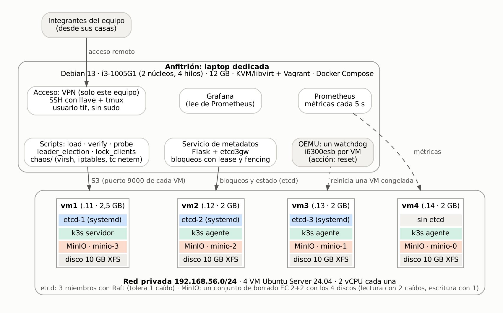

# TIF SOD 2026 · Propuesta C: repositorio académico distribuido y tolerante a fallos

Prototipo de repositorio documental para una universidad con varias sedes. El contenido de los documentos se guarda en **MinIO** distribuido (codificación de borrado sobre 4 nodos); el estado de cada documento y los bloqueos, en un clúster **etcd** de 3 miembros (consenso Raft). Un **servicio de metadatos** impide que dos usuarios modifiquen a la vez el mismo documento, con bloqueos atados a un *lease* y *fencing tokens*. Sobre esa base se ejecutan experimentos de **ingeniería del caos** y se verifica la integridad de los documentos con SHA-256.

Trabajo Integrador Final de Sistemas Operativos Distribuidos, Facultad de Ingeniería, Tecnología y Arquitectura.

## Empezar por acá

| Quiero… | Dónde |
|---|---|
| Ver qué se probó y qué dio | [Resultados en una tabla](#resultados-en-una-tabla) y [`docs/postmortems/`](docs/postmortems/) |
| Armar todo desde cero | [Requisitos](#requisitos) y [Cómo levantarlo](#cómo-levantarlo) |
| Prender, apagar o ver el estado del sistema ya armado | `scripts/tif prender`, `scripts/tif apagar`, `scripts/tif estado` |
| Mostrarlo funcionando y fallando delante de alguien | [`demo/`](demo/README.md): cada paso es un comando |
| Correr un experimento de caos completo | [`chaos/`](chaos/README.md): `chaos/jornada.sh e1-uno`, `e3`, `e4`… |
| Saber qué hace cada script | El README de cada carpeta (tabla de abajo) |
| Ver los datos crudos y las salidas de la terminal | [`results/`](results/README.md) |

## Resultados en una tabla

Todo corrió en una laptop (4 hilos, 12 GB de RAM) con 4 VM, el 12 y el 13/11/2026. El detalle de cada experimento está en su [post-mortem](docs/postmortems/) y los datos crudos, en [`results/`](results/).

| Experimento | Hipótesis | Resultado |
|---|---|---|
| E2 · caída del líder de etcd (10 + 10 corridas) | Hay líder nuevo en menos de 2 s, sin errores | ✅ 1,5 s de mediana con `kill -9`, 62 ms con `stop`; 0 errores |
| E5 · bloqueo huérfano y *fencing* | Un solo dueño; el bloqueo se libera solo; el token viejo se rechaza | ✅ 11,85 s hasta liberarse (TTL de 15 s); el token viejo recibe 409 |
| E4 · red degradada (200 ms, 5 % de pérdida, 5 min) | Funciona, más lento | ✅ 0 errores en 1.953 pedidos; latencia de la API de 53 a 1.050 ms (p95) |
| E3 · partición (vm3 aislada 60 s) | La minoría rechaza escrituras; sin divergencia | ✅ en etcd; en MinIO, en parte (la mayoría también se demoró) |
| E1 · un nodo caído | Lee y escribe | ✅ sin pérdida de datos, con 58 s sin lecturas al principio |
| E1 · dos nodos caídos | Solo lecturas | ⚠️ apagados de golpe, MinIO no sirvió ni lecturas ni escrituras; ✅ apagados en orden, leyó todo (1.000 actas en 4 s). La causa es que MinIO tarda en detectar a un nodo que muere sin avisar |
| Integridad (SHA-256 de 1.000 actas) | 1.000 de 1.000 siempre | ✅ en cada verificación, también la final |

Además, el 12/11 una VM se congeló sola durante más de 4 horas; el sistema la toleró y por eso nadie lo notó. Se agregó un *watchdog* que la reinicia en 35 s ([post-mortem](docs/postmortems/2026-11-12-vm3.md)).

## Qué hay en cada carpeta

Cada carpeta tiene su propio README con qué hace cada archivo y cómo se usa.

| Carpeta | Contenido |
|---|---|
| [`vagrant/`](vagrant/README.md) | Las 4 VM: KVM/libvirt (principal) o VirtualBox (alternativa) |
| [`ansible/`](ansible/README.md) | Aprovisionamiento de las VM: paquetes, disco de datos, etcd, k3s, node_exporter, netem y *watchdog* |
| [`k8s/`](k8s/README.md) | MinIO distribuido (4 pods, uno por VM) |
| [`metadata-service/`](metadata-service/README.md) | API de metadatos con bloqueos (Flask + etcd), sus pruebas y su imagen Docker |
| [`monitoring/`](monitoring/README.md) | Prometheus, Grafana (con el tablero del TIF), node_exporter del anfitrión y la API, con Docker Compose |
| [`scripts/`](scripts/README.md) | Actas de prueba (generar, cargar, verificar), mediciones (E2, E5), sonda, análisis, respaldo, diagnóstico y el comando `tif` |
| [`chaos/`](chaos/README.md) | Inyección de fallas (E1, E3, E4) y `jornada.sh`, que corre cada experimento completo con un comando |
| [`demo/`](demo/README.md) | La demo en vivo: subir un archivo real, tirar el líder, un nodo y la red, y comprobar que nada se perdió |
| [`results/`](results/README.md) | Datos crudos (CSV), salidas de la terminal y figuras de los experimentos |
| [`docs/`](docs/README.md) | Runbook, post-mortems, capturas, figuras del informe, versiones y plan |

## Arquitectura

```
                     red privada 192.168.56.0/24
  vm1 (.11)              vm2 (.12)          vm3 (.13)          vm4 (.14)
  k3s server             k3s agent          k3s agent          k3s agent
  etcd-1                 etcd-2             etcd-3             -
  un pod de MinIO        un pod de MinIO    un pod de MinIO    un pod de MinIO

  Anfitrión (Docker, red host): API de metadatos :8000 · Prometheus :9090 · Grafana :3000
  Anfitrión: scripts de carga, verificación, medición y caos
```



- etcd corre como servicio systemd, separado del almacén interno de k3s, para poder detener a su líder sin afectar a Kubernetes.
- MinIO forma un único conjunto de borrado de 4 unidades (EC:2): lee con 2 unidades y escribe con 3. Con 2 nodos apagados en orden leyó sin problemas; apagados de golpe, no: cada pedido espera a los nodos muertos más que el límite del cliente (E1).
- Cada pod de MinIO expone el puerto 9000 en su nodo (`hostPort`), para hablarle a una unidad concreta. Kubernetes elige qué pod va en cada VM: en el clúster del TIF quedaron `minio-0` en vm4, `minio-1` en vm3, `minio-2` en vm2 y `minio-3` en vm1.
- Cada VM tiene un *watchdog* virtual (`i6300esb`, acción `reset`): si el sistema se congela, QEMU la reinicia.

## Requisitos

- **Anfitrión:** Linux con KVM/libvirt y el plugin vagrant-libvirt (o VirtualBox), Vagrant 2.3 o más nuevo, Ansible, kubectl 1.36, Docker con Compose y Python 3.11 o más nuevo. Las versiones exactas usadas están en [docs/versiones.md](docs/versiones.md).
- **Recursos:** unos 10 GB de RAM libres (las VM usan 8,5 GB) y 30 GB de disco. Con 4 hilos de CPU alcanza, pero la CPU es el límite en las pruebas de rendimiento.
- **Tiempo:** levantar todo desde cero lleva alrededor de una hora; la mayor parte es la descarga de la imagen de las VM y el aprovisionamiento.

## Cómo levantarlo

```bash
# 1. Máquinas virtuales
cd vagrant
vagrant up --provider=libvirt     # o: vagrant up --provider=virtualbox
vagrant ssh-config | sed 's/LogLevel FATAL/LogLevel ERROR/' > ../ansible/ssh_config   # FATAL ocultaría los errores de conexión

# 2. Aprovisionamiento (etcd, k3s, node_exporter y watchdog)
cd ../ansible
K3S_TOKEN='<token-largo>' ansible-playbook site.yml
export KUBECONFIG=$PWD/../kubeconfig
kubectl get nodes                 # 4 nodos Ready
ssh -F ssh_config vm1 'etcdctl --endpoints=192.168.56.11:2379,192.168.56.12:2379,192.168.56.13:2379 endpoint status -w table'

# 3. MinIO
kubectl create namespace minio
kubectl -n minio create secret generic minio-creds \
  --from-literal=MINIO_ROOT_USER=admin --from-literal=MINIO_ROOT_PASSWORD='<contraseña>'
kubectl apply -f ../k8s/minio.yaml
kubectl -n minio get pods -o wide                       # 4 pods Running, uno por VM
curl -s -o /dev/null -w '%{http_code}\n' http://192.168.56.11:9000/minio/health/cluster   # 200: hay quórum de escritura

# 4. Monitoreo y API de metadatos (Docker en el anfitrión, red host)
cd ../monitoring
cp .env.example .env              # y poner la contraseña de Grafana
docker compose up -d --build      # Grafana :3000 (tablero "TIF · Estado del sistema"), Prometheus :9090, API :8000
# El tablero se abre directo en http://<anfitrión>:3000/d/tif-estado (también: Dashboards > TIF)

# 5. Actas de prueba: generar, subir y verificar (el bucket se crea solo)
cd ../scripts
python3 -m venv ../.venv && . ../.venv/bin/activate && pip install -r requirements.txt
export MINIO_USER=admin MINIO_PASS='<contraseña>'
python generar_actas.py           # 1.000 actas ficticias (PDF y texto, ~0,4 GB) en ../dataset/actas
python load.py                    # sube, registra cada SHA-256 y escribe ../results/manifest.csv (MB/s de escritura)
python verify.py                  # baja todo y compara los hashes (MB/s de lectura)

# 6. Estado estable: todo tiene que salir con ✓
cd .. && chaos/jornada.sh estado
```

**Atajo para el día a día:** `scripts/tif prender`, `scripts/tif estado` y `scripts/tif apagar` hacen los pasos 1 y 4 (y el apagado ordenado) con un comando; instalado en `/usr/local/bin` con una regla de sudoers, un integrante puede ver el estado sin tener otros permisos de administrador. El encabezado del script explica cómo instalarlo y los ganchos para frenar otros servicios del anfitrión y liberar memoria.

Si las VM ya estaban creadas antes de agregar el *watchdog* al Vagrantfile: `ansible-playbook site.yml --tags watchdog` y después `scripts/watchdog_vms.sh`, que se lo agrega y las reinicia de a una.

**Cuidado con el firewall del anfitrión:** Docker publica los puertos saltando las reglas de UFW. Por eso el monitoreo usa la red del anfitrión (`network_mode: host`) y queda bajo el firewall: abrir 3000, 8000 y 9090 solo para la red local o la VPN.

## Experimentos

La forma recomendada es `chaos/jornada.sh`: un comando por experimento, que controla el estado estable, prende las sondas, inyecta la falla, la revierte (también si se corta con Ctrl+C), espera a que el clúster vuelva a estar completo, verifica las 1.000 actas y analiza las sondas. Todo queda en `results/` con la hora de inicio en el nombre.

```bash
cd ~/TIF-SOD            # con el venv activo, MINIO_USER, MINIO_PASS y KUBECONFIG
chaos/jornada.sh estado    # controles de estado estable; no cambia nada
chaos/jornada.sh e4        # red degradada: 5 min de netem (200 ms y 5 % de pérdida) en las 4 VM
chaos/jornada.sh e3        # partición: vm3 aislada de las otras tres VM durante 60 s
chaos/jornada.sh e1-uno    # caída de un nodo: vm4 apagada de golpe durante 150 s
chaos/jornada.sh e1-dos    # caída de dos nodos: vm4 y vm3 apagadas; vuelve vm3 y después vm4
```

E2 y E5 se miden con sus propios scripts, desde `scripts/`:

```bash
# E2: elección de líder de etcd, 10 corridas por modo, con la sonda en otra terminal
python probe.py meta --etiqueta e2-kill --intervalo 0.1 --salida ../results/e2_sonda_meta_kill.csv
python leader_election.py --modo kill --repeticiones 10 --salida ../results/e2_kill.csv
python leader_election.py --modo stop --repeticiones 10 --salida ../results/e2_stop.csv

# E5: exclusión mutua, bloqueo huérfano y fencing
python lock_clients.py concurrencia --clientes 2
python lock_clients.py huerfano --repeticiones 5 --salida ../results/e5_kill.csv
python lock_clients.py huerfano --ordenado --repeticiones 5 --salida ../results/e5_ordenado.csv
python lock_clients.py fencing

# Verificación de los hashes (también la corre jornada.sh después de cada experimento)
python verify.py
```

El guion completo de la jornada está en el [runbook](docs/runbook.md): controles antes de cada falla, criterios para abortar, cómo revertir cada una, y el respaldo y la prueba de restauración. Cada experimento tiene su [post-mortem](docs/postmortems/).

<details>
<summary>Los mismos experimentos de caos, paso a paso y sin <code>jornada.sh</code></summary>

Los scripts de `chaos/` y `leader_election.py` anotan la hora de cada falla en `results/eN_eventos.csv`; la **sonda** (`probe.py`) hace una lectura y una escritura cada 0,5 s y anota cada pedido, así después se cruzan las dos cosas. La sonda se arranca antes de inyectar la falla y se corta con Ctrl+C (o `kill`) cuando el sistema volvió al estado estable.

```bash
cd scripts

# E1: caída de un nodo, con la sonda corriendo en otra terminal
python probe.py s3 --etiqueta e1 --salida ../results/e1_sonda_s3.csv
../chaos/e1_caida_nodo.sh apagar vm4       # observar un par de minutos
../chaos/e1_caida_nodo.sh encender vm4

# E3: partición. Una sonda por lado, contra etcd y contra MinIO.
python probe.py etcd --nodos 192.168.56.13:2379 --etiqueta e3-vm3 --salida ../results/e3_etcd_vm3.csv &
python probe.py etcd --nodos 192.168.56.11:2379 --etiqueta e3-vm1 --salida ../results/e3_etcd_vm1.csv &
python probe.py s3 --nodos http://192.168.56.13:9000 --etiqueta e3-vm3 --salida ../results/e3_s3_vm3.csv &
python probe.py s3 --nodos http://192.168.56.11:9000 --etiqueta e3-vm1 --salida ../results/e3_s3_vm1.csv &
../chaos/e3_particion.sh aislar vm3; sleep 60; ../chaos/e3_particion.sh revertir vm3; sleep 30; kill %1 %2 %3 %4
# Consistencia final: qué escrituras ve cada nodo después de reunificar
python probe.py etcd --comprobar ../results/e3_etcd_vm1.csv ../results/e3_etcd_vm3.csv
python probe.py s3 --comprobar ../results/e3_s3_vm1.csv ../results/e3_s3_vm3.csv

# E4: red degradada
python probe.py s3 --etiqueta e4 --salida ../results/e4_sonda_s3.csv &
../chaos/e4_netem.sh aplicar; sleep 300; ../chaos/e4_netem.sh revertir; sleep 60; kill %1
```
</details>

### Tablas y figuras

`analyze.py` imprime tablas en Markdown, con coma decimal, y guarda cada figura en PNG. Para cada experimento salen la disponibilidad, la latencia p50 y p95 y el corte más largo por tramo (antes, durante y después de la falla), y, para cada evento, cuánto tardó en aparecer el primer error y cuánto en recuperarse el servicio.

```bash
python analyze.py eleccion ../results/e2_kill.csv ../results/e2_stop.csv --figura ../results/figuras/e2.png
python analyze.py sonda ../results/e1_uno_sonda_s3_1523.csv ../results/e1_uno_sonda_meta_1523.csv \
    --eventos ../results/e1_eventos.csv --figura ../results/figuras/e1-uno.png
python analyze.py huerfano ../results/e5_kill.csv ../results/e5_ordenado.csv --figura ../results/figuras/e5.png
```

Las figuras propias del informe salen de [`docs/figuras/graficos.py`](docs/figuras/).

## Respaldo y restauración

```bash
cd scripts
./respaldo.sh etcd                                   # instantánea de etcd en ../respaldo/etcd-AAAAMMDD-HHMM.db
./respaldo.sh probar-etcd ../respaldo/etcd-...db     # la restaura en un etcd temporal y cuenta las actas
python verify.py --copia ../respaldo/actas           # verifica las actas y guarda una copia en la misma pasada
```

`respaldo/` no se sube al repositorio. La política completa (regla 3-2-1, versionado, réplica a otra sede) está en la sección 6.4 del informe.

## Herramientas de diagnóstico

| Script | Para qué |
|---|---|
| `scripts/tif estado` | VMs, contenedores, memoria, disco y temperatura del anfitrión |
| `scripts/caidas.py --vm vm3 --horas 8` | Cuándo dejó de responder una VM, según Prometheus, y cómo estaba la memoria antes |
| `scripts/probar_watchdog.sh vm4` | Cuelga a propósito el núcleo de una VM y mide cuánto tarda en volver sola |
| `scripts/watchdog_vms.sh` | Agrega el *watchdog* a las VM ya creadas y las reinicia de a una |

## Demo en vivo

[`demo/`](demo/README.md) tiene la demostración paso a paso: `demo/demo.sh <paso>` dice antes qué tiene que verse y, si rompe algo, lo arregla al terminar. Hay un recorrido completo (carga de un archivo real, caída del líder y de un nodo, partición y verificación) y uno corto de 5 minutos.

## Pruebas del servicio de metadatos

Levantan un clúster etcd real de 3 miembros en la máquina local:

```bash
ETCD_BIN=/ruta/a/etcd python -m pytest -q metadata-service/tests
```

## Problemas conocidos

| Síntoma | Causa | Solución |
|---|---|---|
| Las VM no salen a Internet | Docker deja la cadena FORWARD en DROP y libvirt usa nftables | `firewall_backend = "iptables"` en `/etc/libvirt/network.conf` |
| `vagrant up` no encuentra la box | Canonical no publica boxes desde Ubuntu 24.04 | Se usa `bento/ubuntu-24.04` (pide Vagrant 2.4; en Debian anduvo la 2.3.8) |
| Los pods de MinIO quedan en `ImagePullBackOff` | Desde el 24/09/2026, quay.io no permite descargas anónimas de `minio/minio` | Se usa el fork `pgsty/minio` (misma API y métricas) |
| Ansible no dice por qué no conecta | El `ssh_config` de Vagrant trae `LogLevel FATAL` | Generarlo con `LogLevel ERROR` (paso 1) |
| Una VM queda `running` pero no responde | Falla gris del sistema invitado | El *watchdog* la reinicia ([post-mortem](docs/postmortems/2026-11-12-vm3.md)) |
| Con un nodo apagado de golpe, MinIO tarda casi un minuto en volver a responder; con dos, no vuelve a leer a tiempo | MinIO espera a los nodos que desaparecen sin cerrar sus conexiones | Con uno, esperar un minuto antes de medir; con dos, prender uno ([post-mortem de E1](docs/postmortems/2026-11-13-e1.md)) |

## Estado del trabajo

Ver [docs/plan.md](docs/plan.md).
